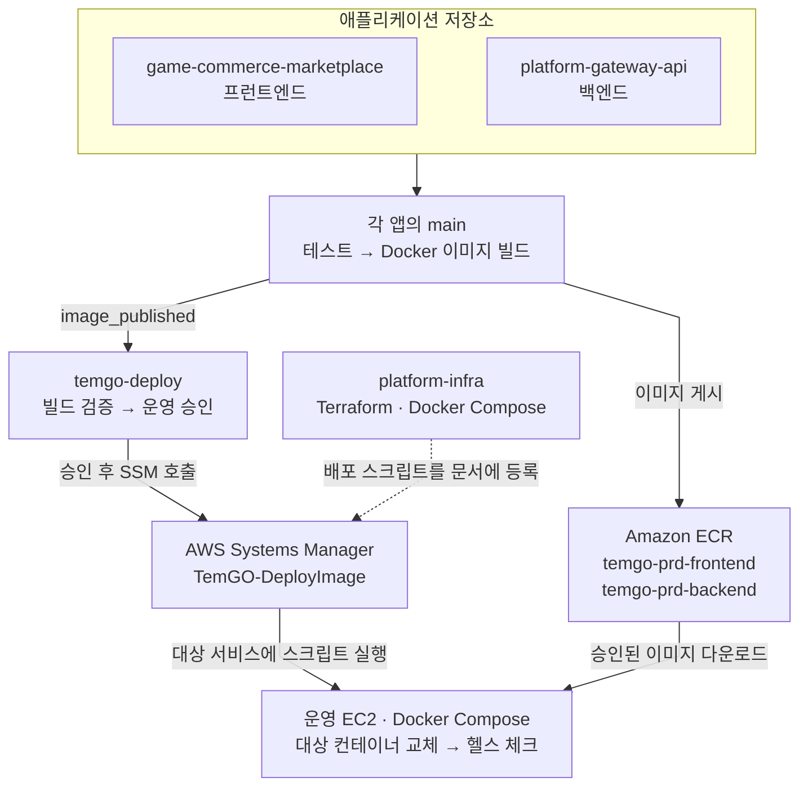

# TemGO CI/CD

프런트엔드와 백엔드는 각 저장소에서 테스트한 이미지를 ECR에 게시합니다. `temgo-deploy`는 그 이미지의 빌드 기록을 확인하고 운영 승인을 받은 뒤, 서울 리전(`ap-northeast-2`)의 EC2에서 대상 서비스 하나를 재배포합니다.

## 전체 아키텍처

| 저장소 | 관리하는 부분 |
| --- | --- |
| `game-commerce-marketplace` | 프런트엔드 테스트·이미지 게시·배포 요청. [build.yaml](https://github.com/xreward/game-commerce-marketplace/blob/main/.github/workflows/build.yaml) |
| `platform-gateway-api` | 백엔드 테스트·이미지 게시·배포 요청. [build.yaml](https://github.com/xreward/platform-gateway-api/blob/main/.github/workflows/build.yaml) |
| `temgo-deploy` | 두 앱의 배포 요청을 받아 검증·승인·SSM 호출을 진행합니다. [deploy.yaml](.github/workflows/deploy.yaml) |
| `platform-infra` | AWS ECR·IAM·SSM을 Terraform으로 관리하고, EC2에서 사용할 Compose와 배포 스크립트를 정의합니다. [SSM 문서 정의](https://github.com/xreward/platform-infra/blob/main/github-deploy-ssm.tf) · [Compose 설정](https://github.com/xreward/platform-infra/blob/main/deploy/compose.yaml) |

## 실제 실행 순서

### 1. 테스트하고 이미지를 게시합니다

- `main` 대상 PR에서는 테스트를 실행합니다. 프런트엔드는 Node.js 22에서 `npm ci`와 `npm test`를 실행합니다. 백엔드는 Python 3.13과 `uv`, 테스트용 PostgreSQL을 사용해 채팅·마켓플레이스·결제 테스트를 실행합니다. 백엔드 CI가 실행하는 테스트 목록은 위 `build.yaml`의 `test` 작업에 있습니다.
- PR 머지나 푸시로 `main`이 갱신되면 테스트를 다시 실행합니다. 통과하면 해당 앱의 AWS 게시 역할을 GitHub OIDC로 받아 Docker 이미지를 전용 ECR 저장소에 게시합니다.
- 이미지 태그는 `sha-<전체 Git 커밋 SHA>`입니다. ECR의 태그는 `IMMUTABLE`이며, 같은 커밋을 다시 실행하면 기존 이미지를 재사용합니다. 빌드는 이미지 다이제스트에 대응하는 Actions 아티팩트도 남깁니다.

### 2. 배포 요청을 검증하고 운영 승인을 받습니다

이미지 게시 후 앱의 `notify` 작업이 Dispatch App을 통해 `image_published` 이벤트를 보냅니다. 요청에는 서비스명, 원본 저장소, 커밋 SHA, 이미지 다이제스트, 빌드 실행 ID가 담깁니다.

`temgo-deploy`의 `verify` 작업은 발신 App과 원본 저장소를 확인합니다. 이어 조회용 App으로 해당 커밋의 `main` 빌드가 성공했고, 요청한 다이제스트에 해당하는 유효한 아티팩트가 있는지 확인합니다.

승인자는 실행의 **Summary**에서 서비스·커밋·다이제스트를 확인하고 **Review deployments → production → Approve and deploy**를 누릅니다. `production` 환경에는 필수 승인자와 `main` 브랜치 제한이 설정돼 있습니다. [배포 실행 목록](https://github.com/xreward/temgo-deploy/actions/workflows/deploy.yaml)

### 3. EC2에서 승인된 서비스만 교체합니다

1. 승인 후 `deploy` 작업이 GitHub OIDC로 AWS 운영 배포 역할을 사용합니다. ECR의 커밋 태그가 검증한 다이제스트와 일치하면 SSM 문서 `TemGO-DeployImage`를 호출합니다. 대상 EC2와 `Service`, `CommitSha`, `Digest`를 전달합니다.
2. `platform-infra`의 Terraform은 `deploy/deploy-image.sh`를 SSM 문서 안에 등록합니다. 실행 시 EC2의 SSM Agent가 문서에 들어 있는 스크립트를 실행합니다. [배포 스크립트](https://github.com/xreward/platform-infra/blob/main/deploy/deploy-image.sh)
3. 스크립트는 승인된 다이제스트의 이미지를 내려받고 `/opt/temgo/repo/deploy/versions.env`에 대상 앱의 버전을 `sha-<커밋 SHA>@sha256:<다이제스트>`로 기록합니다. Compose는 `FRONTEND_TAG` 또는 `BACKEND_TAG`를 읽고 해당 서비스 컨테이너 하나를 교체합니다.
4. 컨테이너가 `healthy`가 되고 해당 앱의 HTTPS 헬스 체크가 통과하면 SSM이 `Success`를 반환합니다. GitHub Actions는 이 결과를 받아 배포를 완료합니다.

GitHub의 `temgo-production` 동시성 그룹과 EC2의 파일 잠금으로 운영 배포를 한 건씩 처리합니다. Compose나 Caddy 설정을 바꿀 때는 해당 파일을 EC2에 동기화하고, 배포 스크립트를 바꿀 때는 Terraform으로 SSM 문서를 갱신합니다.

## GitHub와 AWS 설정

### GitHub Apps

| App | 설치 대상 | 권한과 용도 |
| --- | --- | --- |
| `temgo-deploy-dispatch` | `temgo-deploy` | `Contents`의 **Read and write**로 배포 요청 전송 |
| 빌드 조회용 App | `game-commerce-marketplace`, `platform-gateway-api` | `Actions`의 **Read-only**로 빌드 기록과 아티팩트 확인 |

각 App의 Client ID와 PEM은 같은 App에서 가져옵니다. Repository Variables와 Secrets는 **Settings → Secrets and variables → Actions**에, 운영 환경 Secret은 **Settings → Environments → production**에 등록합니다.

| 설정 위치 | Variables | Secrets |
| --- | --- | --- |
| 프런트엔드와 백엔드 각각 | `AWS_PUBLISH_ROLE_ARN`, `DEPLOY_APP_CLIENT_ID` | `DEPLOY_APP_PRIVATE_KEY` |
| 프런트엔드 | `NEXT_PUBLIC_TOSS_CLIENT_KEY`, `NEXT_PUBLIC_GATEWAY_API_URL`, `NEXT_PUBLIC_GATEWAY_WS_URL` | — |
| `temgo-deploy` | `DEPLOY_APP_SLUG`, `BUILD_READER_APP_CLIENT_ID` | `BUILD_READER_APP_PRIVATE_KEY` |
| `temgo-deploy`의 `production` | — | `AWS_DEPLOY_ROLE_ARN`, `EC2_INSTANCE_ID` |

`DEPLOY_APP_SLUG`에는 `temgo-deploy-dispatch`를 넣습니다. 프런트엔드 API·웹소켓의 기본 주소는 각각 `https://api.temgo.kr`과 `wss://api.temgo.kr`입니다. `NEXT_PUBLIC_*`는 이미지 빌드 때 적용되므로 값을 바꾼 뒤 새 커밋으로 이미지를 게시합니다.

앱별 AWS 게시 역할은 각 앱의 `main`에서 ECR에 접근합니다. 운영 배포 역할은 `temgo-deploy`의 `production`에서 ECR 확인 및 SSM 호출에 사용합니다. 역할 ARN과 EC2 ID는 Terraform 출력에서 확인합니다. [IAM 설정](https://github.com/xreward/platform-infra/blob/main/github-iam.tf) · [Terraform 출력](https://github.com/xreward/platform-infra/blob/main/outputs.tf)

## 결과 확인과 복원

1. 앱의 Actions에서 테스트와 ECR 게시 성공을 확인합니다. `temgo-deploy`의 **Summary**에서 승인한 다이제스트와 SSM 명령 ID를 확인합니다.
2. AWS **Systems Manager → Run Command → Command history**에서 명령이 `Success`인지 확인합니다. EC2에서는 실행 중인 컨테이너의 다이제스트가 승인한 ECR 이미지와 일치하는지 대조합니다.
3. [프런트엔드](https://temgo.kr/)와 [백엔드 헬스 체크](https://api.temgo.kr/health)를 확인하고, 실제 변경한 기능을 테스트합니다.

| 검증한 배포 | 결과 |
| --- | --- |
| 백엔드 `43424c3` | 새 백엔드 이미지가 EC2에서 실행됐고 `/health`는 `200`을 반환했습니다. [배포 기록](https://github.com/xreward/temgo-deploy/actions/runs/45873468326) |
| 프런트엔드 `49af3d8` | 판매등록 페이지가 비로그인 요청을 `/login`으로 `307` 리다이렉트했습니다. 배포 전후 백엔드의 컨테이너 ID는 동일했습니다. [빌드 기록](https://github.com/xreward/game-commerce-marketplace/actions/runs/46035117125) · [배포 기록](https://github.com/xreward/temgo-deploy/actions/runs/46035384253) |

이전 배포의 ECR 이미지와 빌드 아티팩트가 남아 있고 GitHub에서 재실행할 수 있다면, 해당 실행을 **Re-run all jobs**로 다시 실행하고 운영 승인해 이전 버전으로 복원할 수 있습니다. [인프라 운영 가이드](https://github.com/xreward/platform-infra/blob/main/docs/ci-cd-architecture.md)
